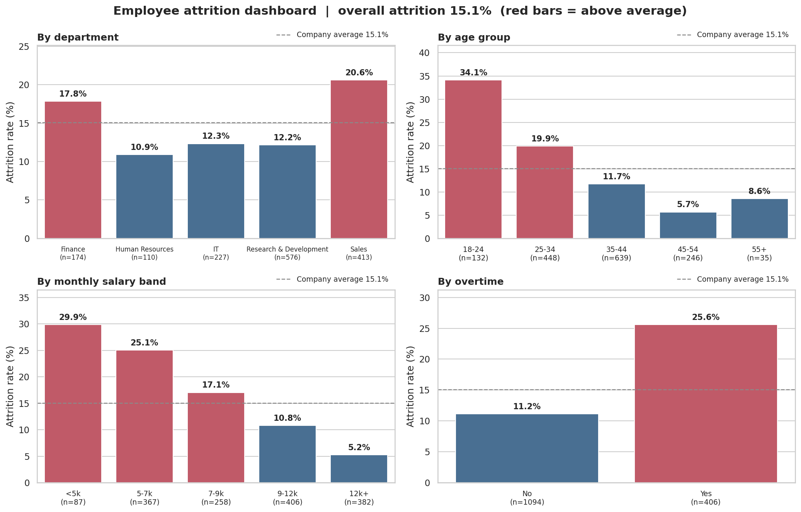
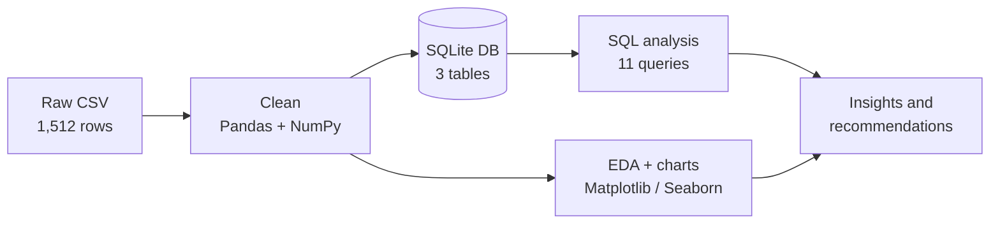
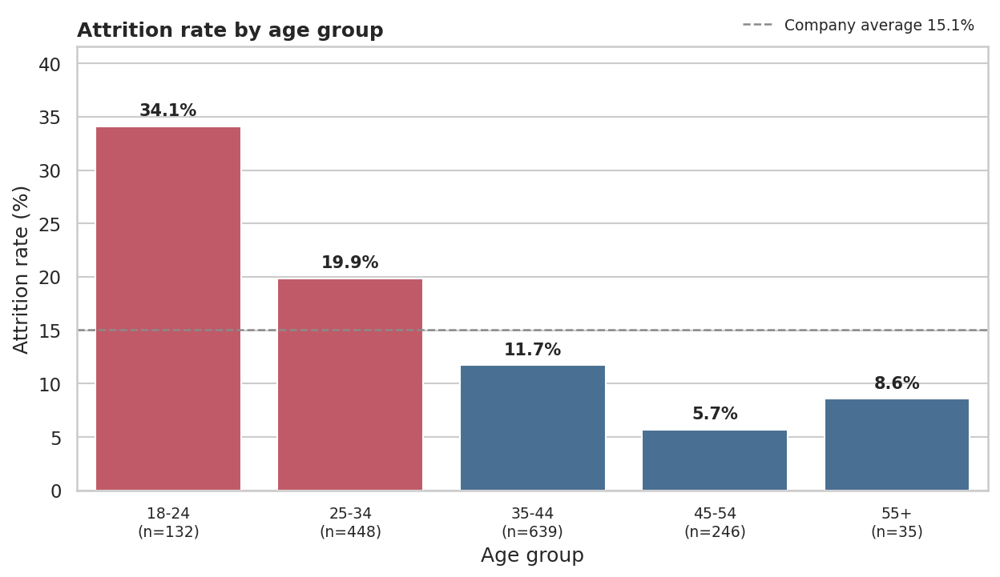
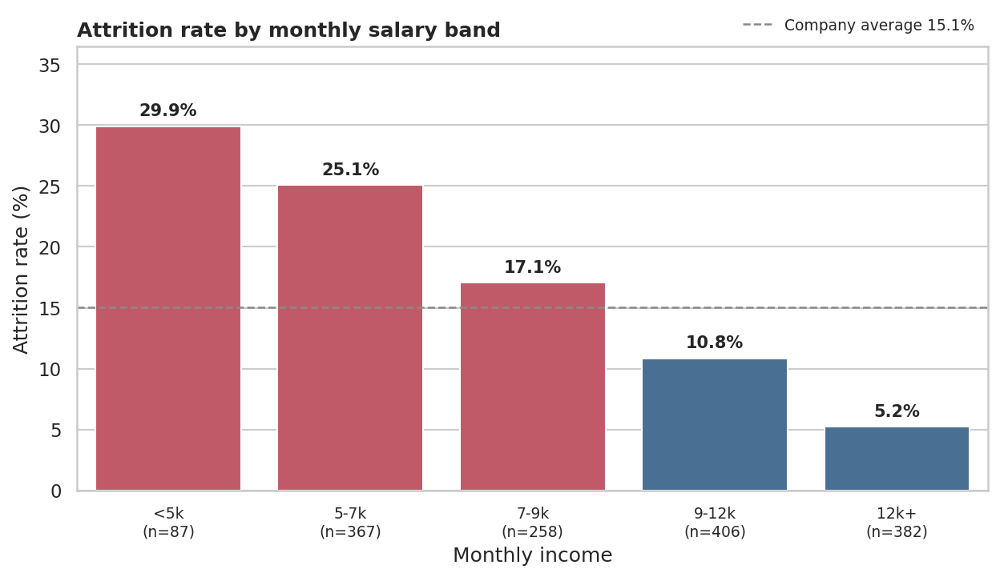
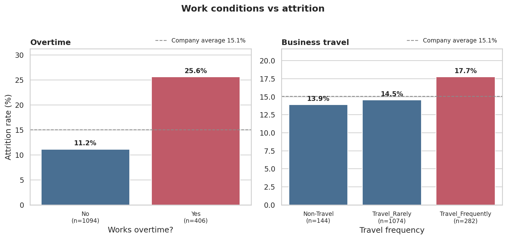
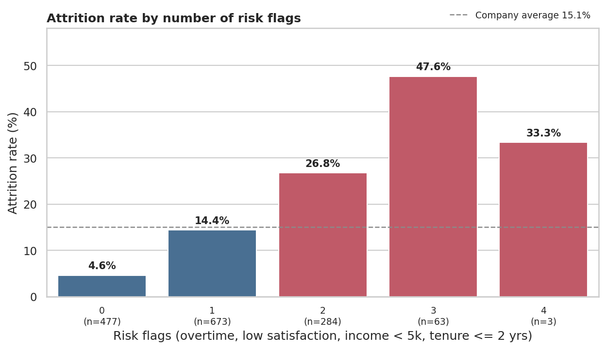
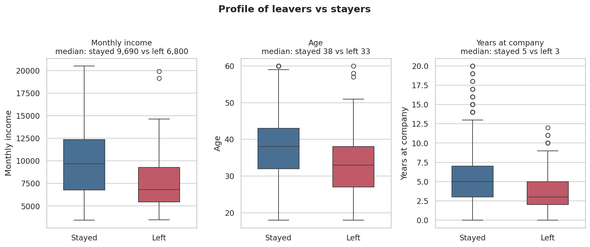
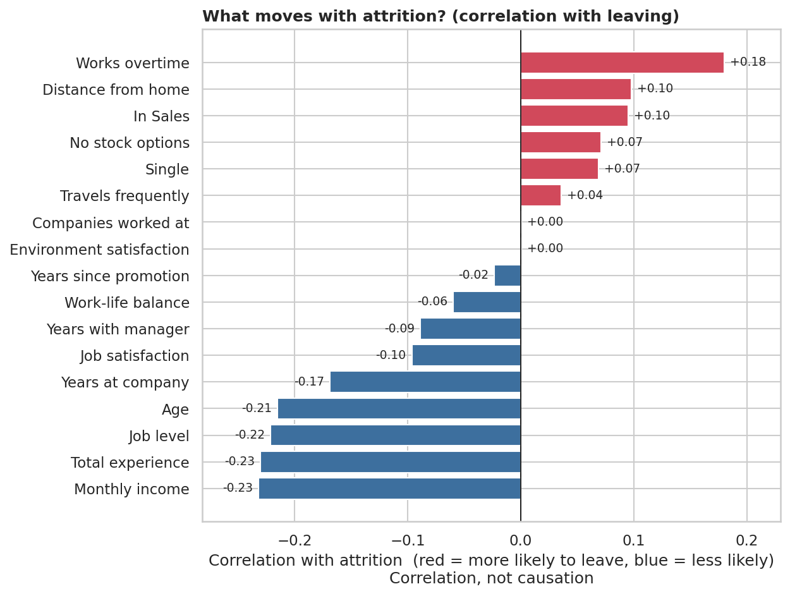

# 📊 Employee Attrition Analysis


An end-to-end HR analytics project that answers one question: **who is leaving the company, and what do they have in common?**
It covers data cleaning, SQL analysis, exploratory data analysis (EDA), visualisation and practical retention recommendations.



> **📌 Data note:** This repository uses a **synthetic dataset** (1,500 employees, fixed random seed) that mirrors the column structure of the public *IBM HR Analytics Employee Attrition* dataset. It lets the whole project run with no downloads. The figures below describe this synthetic data. To analyse the real dataset, see [Using real data](#-using-real-data).

---

## 📑 Table of contents
- [Project at a glance](#-project-at-a-glance)
- [Workflow](#-workflow)
- [Tech stack](#-tech-stack)
- [Data cleaning](#-data-cleaning)
- [SQL analysis](#-sql-analysis)
- [Key findings](#-key-findings)
- [Recommendations](#-recommendations)
- [Skills demonstrated](#-skills-demonstrated)
- [Limitations and next steps](#-limitations-and-next-steps)
- [Repository structure](#-repository-structure)
- [How to run](#-how-to-run)
- [Using real data](#-using-real-data)
- [Author](#-author)

---

## 🎯 Project at a glance

| | |
|---|---|
| **Dataset** | 1,500 employees, 23 raw columns (demographics, role, pay, work conditions, satisfaction, attrition) |
| **Overall attrition** | **15.1%** (226 leavers) |
| **Database** | SQLite with 3 related tables |
| **SQL queries** | 11 (JOINs, GROUP BY, CASE, HAVING, CTE) |
| **Charts** | 13 (Matplotlib and Seaborn) |
| **Output** | Findings and 7 recommendations to improve retention |

## 🔄 Workflow



## 🛠 Tech stack

| Area | Tools |
|---|---|
| Querying | SQL (SQLite): JOIN, GROUP BY, CASE, HAVING, CTE |
| Data cleaning and EDA | Python, Pandas, NumPy |
| Visualisation | Matplotlib, Seaborn |
| Version control | Git and GitHub |

## 🧹 Data cleaning

The raw file was deliberately messy. Every change is logged in [`outputs/cleaning_log.txt`](outputs/cleaning_log.txt).

| Issue | Action |
|---|---|
| 12 exact duplicate rows | Removed |
| Department spelled 12 different ways (case, extra spaces) | Standardised to 5 clean values |
| `Attrition` labels with casing/space errors | Trimmed and normalised to `Yes` / `No` |
| 3 impossible ages (150) | Treated as missing, then imputed |
| 28 missing monthly incomes | Imputed with the median for the employee's job level |
| 18 missing commute distances | Imputed with the overall median |
| Logical checks (years at company vs total experience, IQR outliers) | Verified, no changes needed |

## 🗄 SQL analysis

The cleaned data is loaded into three related tables:

```
departments (dept_id PK, dept_name)
employees   (emp_id PK, age, dept_id FK, job_role, years_at_company, overtime, job_satisfaction, attrition, ...)
compensation(emp_id PK/FK, monthly_income, percent_salary_hike, stock_option_level, ...)
```

All 11 queries are in [`sql/02_analysis_queries.sql`](sql/02_analysis_queries.sql). They cover attrition by department, age group, salary band, total experience, tenure, overtime and travel, job role, department × salary tier, a leavers-vs-stayers profile, and a risk-flag score.

**Example: attrition by salary band**

```sql
SELECT CASE WHEN c.monthly_income < 5000  THEN '1. Under 5,000'
            WHEN c.monthly_income < 7000  THEN '2. 5,000-6,999'
            WHEN c.monthly_income < 9000  THEN '3. 7,000-8,999'
            WHEN c.monthly_income < 12000 THEN '4. 9,000-11,999'
            ELSE '5. 12,000+' END AS salary_band,
       COUNT(*) AS headcount,
       ROUND(100.0 * SUM(CASE WHEN e.attrition = 'Yes' THEN 1 ELSE 0 END) / COUNT(*), 1) AS attrition_rate_pct
FROM employees e
JOIN compensation c ON c.emp_id = e.emp_id
GROUP BY salary_band
ORDER BY salary_band;
```

| salary_band | headcount | attrition_rate_pct |
|---|---:|---:|
| 1. Under 5,000 | 87 | 29.9 |
| 2. 5,000-6,999 | 367 | 25.1 |
| 3. 7,000-8,999 | 258 | 17.1 |
| 4. 9,000-11,999 | 406 | 10.8 |
| 5. 12,000+ | 382 | 5.2 |

## 🔍 Key findings

Overall attrition is **15.1%**.

1. **Overtime is the strongest signal.** 25.6% attrition with overtime vs 11.2% without (2.3x). Overtime workers are 27% of staff but 46% of leavers.
2. **Early-career employees leave most.** Ages 18-24 leave at 34.1%, vs 5.7% for ages 45-54. Employees with 0-2 years of experience leave at 34.2%, vs 2.4% at 20+ years.
3. **Pay matters.** Attrition falls steadily as income rises, from 29.9% (under 5,000) to 5.2% (12,000+).
4. **New joiners are at risk.** 22.9% attrition for employees with 3 or fewer years at the company, vs 10.5% for the rest.
5. **Sales and Finance are above average.** Sales 20.6% and Finance 17.8%, against 10.9-12.3% for HR, IT and R&D.
6. **Risk factors stack up.** Using four flags (overtime, low job satisfaction, income under 5,000, 2 or fewer years at the company), attrition rises from 4.6% with no flags to 47.0% with three or more.

| Age group | Salary band |
|---|---|
|  |  |

| Overtime and travel | Risk flags |
|---|---|
|  |  |

| Leavers vs stayers | Factors that move with attrition |
|---|---|
|  |  |

More charts (department, experience, tenure, overtime × satisfaction heatmap, correlation matrix) are in [`outputs/charts/`](outputs/charts/).

## 💡 Recommendations

1. **Set guardrails on overtime.** Track hours per team, cap them or require sign-off, and review teams where overtime and attrition are both high.
2. **Build a first-three-years programme.** Structured onboarding, a mentor and a clear 12-24 month growth path for young and recently hired staff.
3. **Review pay in the lower bands.** Benchmark roles paid under about 7,000 a month, starting with Sales and Finance.
4. **Look closely at Sales.** Review targets, commission and workload for Sales Executives and Representatives, and run focused exit interviews.
5. **Widen long-term incentives.** Employees without stock options leave more often (18.1% vs 12.9%).
6. **Use the risk-flag score as an early-warning list.** Offer stay conversations to employees carrying three or more flags.
7. **Measure what you change.** Pilot actions in one department and compare attrition with a control group.

## 🧠 Skills demonstrated

- Writing analytical SQL: multi-table joins, conditional aggregation, banding with CASE, HAVING and CTEs
- Cleaning messy data: duplicates, inconsistent labels, impossible values, group-based imputation
- Exploratory analysis with Pandas and NumPy
- Clear, honest visualisation with Matplotlib and Seaborn
- Turning analysis into business recommendations and stating limitations

## ⚠️ Limitations and next steps

- Findings are **correlations, not causes**. For example, low-paid employees are also younger and more junior.
- Some groups are small (for example, 35 employees aged 55+), so those rates are noisy.
- Band thresholds are judgement calls, and the data is a single snapshot with no time dimension.
- The dataset is synthetic. Patterns reflect how the data was generated, so the value here is the method.
- **Next steps:** run on the real IBM dataset, add chi-square tests, build a logistic regression / random forest to predict attrition (handling the class imbalance), and recreate the dashboard in Power BI.

## 📁 Repository structure

```
employee-attrition-analysis/
├── README.md
├── requirements.txt
├── run_all.py                  # runs the whole pipeline
├── data/
│   ├── raw/                    # messy input CSV
│   └── processed/              # clean CSV + SQLite database
├── sql/
│   ├── 01_schema.sql           # table definitions
│   └── 02_analysis_queries.sql # 11 analysis queries
├── src/
│   ├── 01_generate_data.py
│   ├── 02_clean_data.py
│   ├── 03_build_database.py
│   ├── 04_run_sql_analysis.py
│   └── 05_eda_and_charts.py
└── outputs/
    ├── charts/                 # 13 PNG figures
    ├── sql_results/            # one CSV per query
    ├── cleaning_log.txt
    ├── eda_summary.txt
    └── key_findings.txt
```

## ▶️ How to run

```bash
git clone https://github.com/reena-10/employee-attrition-analysis.git
cd employee-attrition-analysis
pip install -r requirements.txt
python run_all.py
```

This regenerates the data, cleans it, builds the SQLite database, runs all SQL queries and saves the charts and summaries to `outputs/`. SQLite comes with Python, so no database server is needed.

To explore the SQL on its own, open `data/processed/attrition.db` in [DB Browser for SQLite](https://sqlitebrowser.org/) and paste in queries from `sql/02_analysis_queries.sql`.

## 📥 Using real data

1. Download the *IBM HR Analytics Employee Attrition & Performance* CSV from Kaggle.
2. Save it as `data/raw/employee_attrition_raw.csv`.
3. Run the steps **except** `01_generate_data.py` (it would overwrite your file):
   ```bash
   python src/02_clean_data.py
   python src/03_build_database.py
   python src/04_run_sql_analysis.py
   python src/05_eda_and_charts.py
   ```
4. Read the new numbers from `outputs/key_findings.txt` and update the findings above.

The pipeline expects these columns: `EmployeeNumber, Age, Gender, MaritalStatus, Department, JobRole, JobLevel, MonthlyIncome, PercentSalaryHike, StockOptionLevel, TrainingTimesLastYear, TotalWorkingYears, YearsAtCompany, YearsSinceLastPromotion, YearsWithCurrManager, NumCompaniesWorked, DistanceFromHome, BusinessTravel, OverTime, JobSatisfaction, WorkLifeBalance, EnvironmentSatisfaction, Attrition`.

## 👩‍💻 Author

**Reena Mahto**, aspiring Data Analyst

[](https://www.linkedin.com/in/reena23/)
[](https://github.com/reena-10)

If you found this project useful, feel free to ⭐ the repo.
